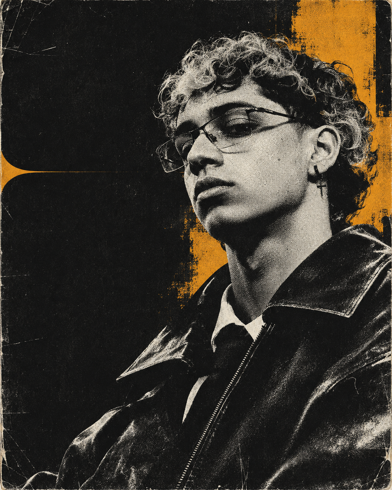
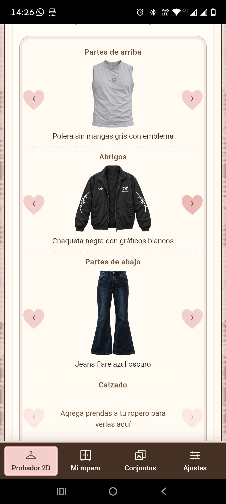
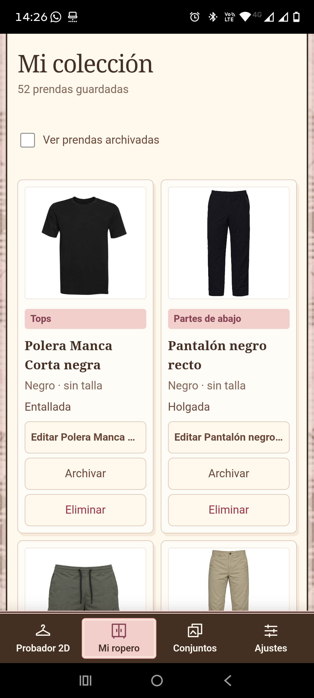
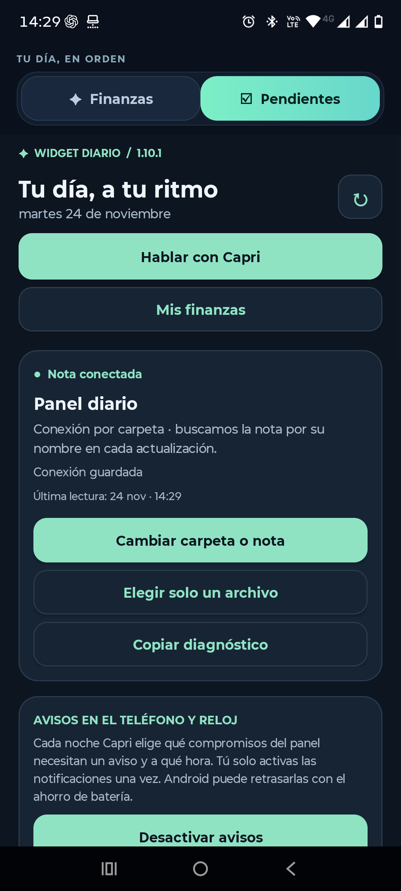

# NiorbDev
*Nicolas Orellana · Ingeniería Civil en Informática · USACH*

## Proyectos

### EntreCapas

Ropero digital para organizar prendas y probar combinaciones por capas en un probador 2D.

 

### NiorbOS

<!-- Pendiente: captura, descripción y enlace verificado. -->

### Fitamon

Premio a la categoría Voto Popular en la Feria de Prototipos FING USACH.

### Widget Diario

App para Android que muestra tareas y agenda desde una nota de Obsidian. El widget permite consultar el panel desde la pantalla de inicio.

 

## Filosofía

Construyo aplicaciones y automatizaciones para resolver problemas cotidianos. Uso IA para explorar alternativas y acelerar prototipos.

## Stack

<!-- Completar con las tecnologías que correspondan a los proyectos mostrados. -->

## Contribuciones

<!-- Incorporar el guiño visual de los tetrominós. -->

## Contacto

[LinkedIn](https://www.linkedin.com/in/nicolas-orellana-badilla)
