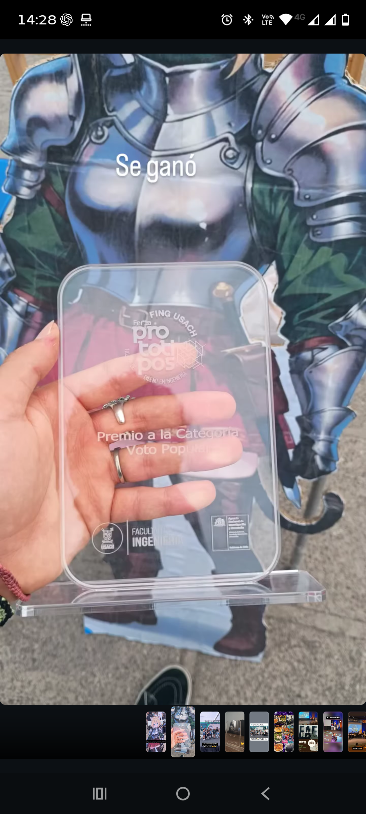
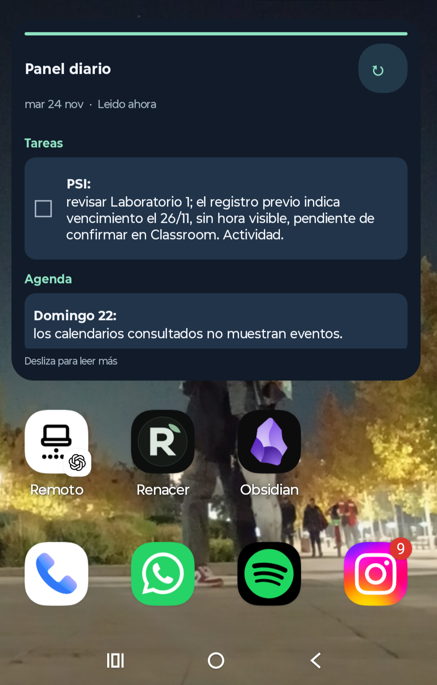

<!-- Las piezas SVG se reconstruyen con pwsh -File scripts/render-editorial.ps1. -->

<strong>EntreCapas</strong> · Ropero digital y probador 2D

Organiza prendas y prueba combinaciones por capas.

 

<!-- NiorbOS conserva su tarjeta en la tira hasta incorporar la captura y el enlace. -->

<strong>Fitamon</strong> · Premio Voto Popular

Reconocido en la Feria de Prototipos FING USACH.

<strong>Widget Diario</strong> · Tareas y agenda en Android

Muestra las tareas y la agenda de una nota de Obsidian desde la pantalla de inicio.

 

<table width="100%">
<tr>
<td width="55%" valign="top">

Construyo aplicaciones y automatizaciones para resolver problemas cotidianos. Uso IA para explorar alternativas y acelerar prototipos.

Java · C y C++ · Python · HTML y CSS

</td>
<td width="45%" valign="top">

Algo se mueve entre mis contribuciones

 

<a href="https://www.linkedin.com/in/nicolas-orellana-badilla">LinkedIn</a>

</td>
</tr>
</table>
