[Ver colección](assets/entrecapas-coleccion.png) · [Ver probador 2D](assets/entrecapas-probador.png)

[Ver foto de la placa](assets/fitamon-premio.png)

[Ver widget](assets/widget-pantalla-inicio.png) · [Ver nota conectada](assets/widget-app.png)

[LinkedIn](https://www.linkedin.com/in/nicolas-orellana-badilla) · [Repositorios](https://github.com/NiorbDev?tab=repositories)
